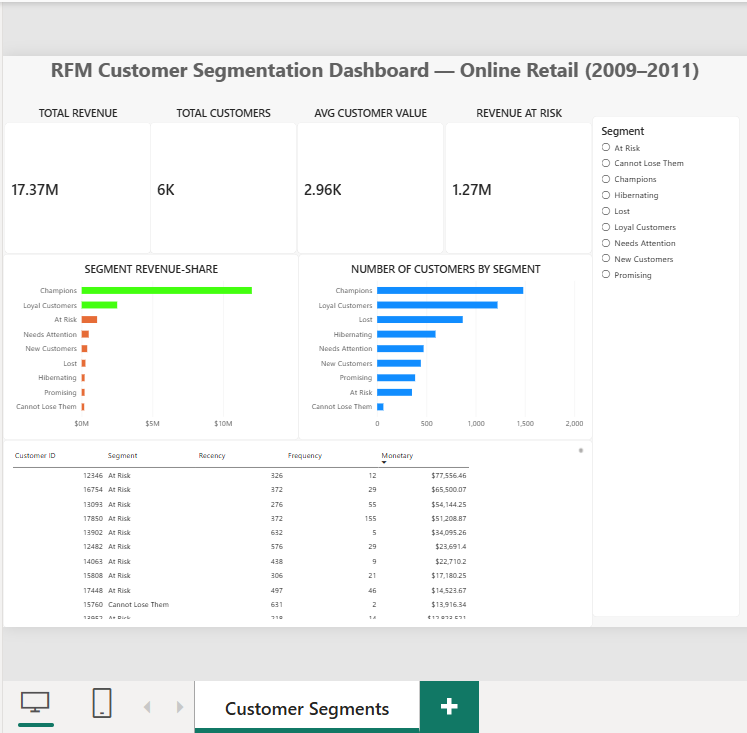

# RFM Customer Segmentation Analysis

**Author: Rishabh Jain**

Segmentation of ~5,900 customers from a UK-based online retailer (Dec 2009 – Dec 2011,
~780,000 transactions) using Recency, Frequency, and Monetary (RFM) analysis and monthly
cohort retention analysis to identify high-value customers, retention risks, and revenue
concentration. Built using Python, SQL, and Power BI.

## Tools Used
- **Python** (Pandas, NumPy, Matplotlib) — data cleaning, RFM scoring, segmentation logic
- **SQL** (SQLite) — segment-level aggregation and validation queries
- **Power BI** — interactive segmentation dashboard

## Method
1. Calculated Recency (days since last order), Frequency (distinct orders), and Monetary
   (total spend) per customer
2. Scored each metric 1–5 using quintiles (5 = best)
3. Mapped R/F score combinations to 9 customer segments (Champions, Loyal, At Risk, Lost, etc.)
   using a standard RFM segmentation framework
4. Built monthly acquisition cohorts (first-purchase month) and measured how much of each
   cohort returns to buy in the following 1–12 months

## Key Insights
- **Revenue is highly concentrated**: Champions and Loyal Customers make up just 46% of
  the customer base but generate 83.7% of total revenue (£14.5M of £17.4M) — a clear
  Pareto pattern worth protecting with retention efforts.
- **Champions alone (25% of customers) drive 69% of revenue** (£12M), averaging 15.7
  orders per customer and purchasing as recently as 20 days ago on average.
- **£1.09M in revenue is sitting in the "At Risk" segment** — 353 customers who were
  previously frequent buyers (avg. 7.6 orders) but haven't purchased in 344 days on
  average. One customer alone (ID 12346) represents £77.5K in historical spend and
  hasn't ordered in 326 days — a strong win-back campaign candidate.
- **"Lost" and "Hibernating" segments (25% of customers) contribute under 3% of
  revenue combined** — low priority for retention spend compared to At Risk customers.
- **Cohort analysis shows the leak is in month one**: only ~21% of a cohort buys again
  the next month, then retention plateaus at 15–22% out to month 11 — so customers who
  survive the first month largely stick. The Dec 2009 cohort (955 customers) held 35%
  at month 1 vs ~15–19% for mid-2010 cohorts, and revenue retention (~21% at M1) tracks
  customer retention closely.

## Files
- `01_Data_Cleaning.ipynb` — data cleaning (removes cancelled orders, missing customer IDs, duplicates)
- `02_rfm_analysis.ipynb` — RFM calculation, scoring, and segmentation logic
- `03_sql_analysis.ipynb` — SQL validation queries (SQLite), win-back target list, Pareto check
- `04_visualization.ipynb` — exploratory visualizations (segment revenue share, recency vs monetary, RF heatmap)
- `05_cohort_analysis.ipynb` — monthly cohort retention matrix, heatmap, and revenue retention
- `rfm_segments.csv` — full customer-level RFM dataset (Power BI data source)
- `cohort_retention_pct.csv`, `cohort_counts.csv` — cohort retention tables (Power BI data source)
- `RFM_Dashboard.pbip` — Power BI Project (semantic model + interactive report, see below)
- `dashboard.png` — Power BI dashboard screenshot

> Raw dataset: [Online Retail II, UCI Machine Learning Repository](https://archive.ics.uci.edu/dataset/502/online+retail+ii)
> (not included here due to file size — `01_Data_Cleaning.ipynb` loads `online_retail_II.xlsx`
> from the project folder or a local download location and reproduces the cleaning steps)

## Dashboard
Interactive Power BI dashboard monitoring customer segments, revenue contribution, the
win-back target list, and cohort retention trends. The dashboard ships as a Power BI
Project (`RFM_Dashboard.pbip`) — the open, text-based format (TMDL semantic model +
PBIR report definition) that Power BI Desktop opens natively and source-control tracks.

**Report pages**
1. **Overview** — KPI cards (total revenue, customers, avg customer value, revenue at
   risk), segment revenue share, customers by segment, and a filtered win-back table
   (At Risk + Cannot Lose Them customers ranked by spend)
2. **Segments** — customers and revenue per segment, recency vs monetary scatter by
   segment, and Champions+Loyal revenue-share / At Risk customer-count cards
3. **Retention Trends** — cohort retention matrix (month-since-first-purchase ×
   acquisition cohort), average retention curve, and month-1 retention card

**Semantic model** — `RFM` and `CohortRetention` tables loaded from the CSVs via
Power Query, with 13 DAX measures (`Total Revenue`, `Revenue at Risk`,
`Champions + Loyal Revenue %`, `Month 1 Retention`, etc.).

**To produce the `.pbix`** (Power BI Desktop on Windows — the pbix binary format is
only authorable in Desktop):
1. Copy this project to a Windows machine
2. Open `RFM_Dashboard.pbip` in Power BI Desktop (enable the *Power BI project (PBIP)
   save* option under Options if prompted)
3. When Power Query opens, set the `DataFolder` parameter to the folder containing
   `rfm_segments.csv` (default `C:\rfm-customer-segmentation`), then **Close & Apply**
4. **File → Save As → Power BI (.pbix)**

## Recommendation
Prioritize a targeted win-back campaign for the 353 "At Risk" customers (£1.09M in
historical revenue) before they churn completely, protect the Champions segment with
loyalty perks given their outsized share of revenue, and add a first-month onboarding
offer — cohort analysis shows ~79% of new customers never make a second purchase.
